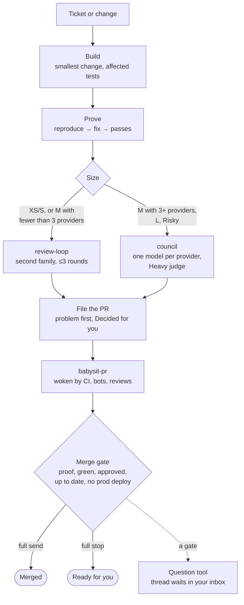
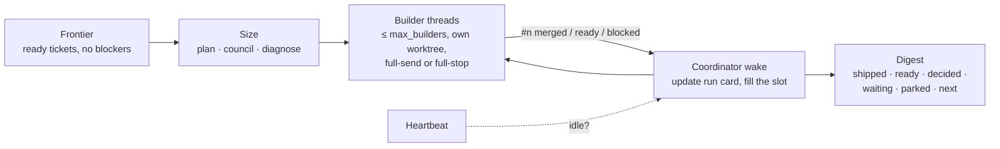

# skills

My set of skills for doing agentic work well: agents that take work to a finished PR while
I'm not watching, in [T3 Code](https://github.com/pingdotgg/t3code),
careful with tokens, and mixing providers (Claude and Codex) in the same run.

The focused PR skills are adapted from Theo Browne's
[tstack](https://github.com/t3dotgg/tstack) (MIT; see [licenses/](licenses/tstack-MIT.txt)).

**Just want it running?** Jump to [Install](#install).

## Contents

- [Principles](#principles)
- [The skills](#the-skills): three heads you say, focused skills they call, no hub
- [How it works](#how-it-works)
  - [One ticket: full send](#one-ticket-full-send)
  - [A backlog: autopilot](#a-backlog-autopilot)
  - [Short threads instead of handoffs](#short-threads-instead-of-handoffs)
  - [Model tiers](#model-tiers)
- [Install](#install)

## Principles

- **The agent finishes the job.** A change runs to a ready PR (`full-stop`) or a merged one
  (`full-send`) without stopping for you between steps. You see results, not progress.
- **Only gates reach you.** Production, money, secrets, destructive or outward-facing
  actions, vendor and legal choices (`autonomy.yaml`). Everything else is decided with the
  most reversible default and listed under "Decided for you".
- **Proof, not green mocks.** A PR merges on evidence the agent observed itself, a review
  that agreed, and CI green.
- **Short threads.** One thread per PR, a fresh context per helper, state in GitHub and a
  run card. Handoffs and compactions become rare.
- **Waiting is event-driven.** PR watches, delegate results and builder reports wake the
  agent; nothing polls.
- **Token efficiency and many providers.** Smaller models by default, stepping up on
  evidence; a Claude and a Codex model per tier; the other family reviews; a council puts
  one model per provider on the hard calls.
- **Built for T3 Code.** Each skill names the T3 tools it uses; autopilot keeps a small host
  map for its coordinator. Every thread starts on a preset model.

## The skills

Say the phrase; the head skill calls the focused ones by name. There is no shared hub
skill: each skill carries the rules it needs, and the shared data is config
(`models.yaml`, `autonomy.yaml`) in `agent-setup`.

| Head | Say | What it does | Calls |
|---|---|---|---|
| [`full-send`](skills/full-send/SKILL.md) | "full send" | One change or ticket to a merged PR, nobody watching: prove, review, file, babysit, merge. Owns the gates and decisions rules. | `review-loop` or `council`, `babysit-pr`, `qa-sweep` |
| [`full-stop`](skills/full-stop/SKILL.md) | "full stop" (and the default for any change you ask for) | The same, stopping at a PR ready for you to merge. | `full-send` |
| [`autopilot`](skills/autopilot/SKILL.md) | "autopilot" | A backlog or epic to done: sizing, one builder thread per ticket, short coordinator wakes, a heartbeat, digests. | `full-send` / `full-stop`, `council`, `takeover` |

| Focused | Say | What it does |
|---|---|---|
| [`council`](skills/council/SKILL.md) | "council" | One strong model per provider in parallel, looping until they agree; for Risky reviews and lasting choices. |
| [`review-loop`](skills/review-loop/SKILL.md) | "review loop" | A second-family reviewer in rounds, with a findings ledger and a 3-round budget. |
| [`babysit-pr`](skills/babysit-pr/SKILL.md) | "babysit" | A PR through CI and review bots: `watch_pull_request` in T3, `pr-wait` elsewhere. |
| [`takeover`](skills/takeover/SKILL.md) | "take over" | Continue a PR, branch, thread or autopilot run as its new owner, keeping credit. |
| [`modernize`](skills/modernize/SKILL.md) | "modernize" | Rebase an old PR and judge whether it should still exist. |
| [`qa-sweep`](skills/qa-sweep/SKILL.md) | "QA sweep" | Device and browser checks that settle on conditions; staging sweeps that file agent-ready issues. |
| [`leaving-pr-comments`](skills/leaving-pr-comments/SKILL.md) | (automatic) | Formats comments an agent posts on your behalf. |

| Setup | What it is for |
|---|---|
| [`agent-setup`](skills/agent-setup/SKILL.md) | Start here. Holds the config (`models.yaml`, `autonomy.yaml`) and the guard hooks; installs, checks or removes the hooks and global instructions for Claude Code and Codex, with a dry run and backups. |

## How it works

### One ticket: full send



### A backlog: autopilot



The coordinator (Heavy) never builds, reviews or babysits: each builder owns its PR and
reports one line back, and that line is the result; the coordinator does not read builder
threads. Blocked builders step up a tier and continue with `takeover`. Every PR wait goes
through `babysit-pr`, never a `sleep` loop.

### Short threads instead of handoffs

A builder's thread lives as long as its PR, and every helper starts fresh, so most threads
end before they need either. When the rotation check fires (~250k tokens for Claude, ~190k
for Codex, or 25 orchestration rounds):

- A coordinator hands off (`autopilot` §5): it updates the run card and launches a
  successor that runs `takeover`.
- A builder keeps going and compacts once (`full-send`, "Context"). A second compaction, a
  context full of wrong turns, or a different model next means a handoff file (format in
  `takeover`) and a `takeover`.

### Model tiers

Every launch names a model and an effort. Defaults and the picking rules live in
[`models.yaml`](skills/agent-setup/models.yaml); your picks go in
`~/.config/agent-setup/models.yaml`. Its `panel` list holds the council's members (a Gemini
slot waits, commented out, for that provider). Judges (autopilot's coordinator, a council's
parent) run Heavy.

| Tier | Claude | Codex | For |
|---|---|---|---|
| **Light** | Haiku · high | `gpt-6-luna` · high | XS work, log and CI summaries, sweeps, QA re-checks |
| **Mid** (default) | Sonnet · medium | `gpt-6.1-sol` · medium | S/M building, QA, tests, routine review |
| **Heavy** (ceiling) | Opus · high | `gpt-6.1-sol` · high | Coordinating, judging a council, planning, diagnosis, Risky review |

## Install

Works with Claude Code, Codex and other agents that read `~/.agents/skills`.

```sh
npx skills add dancorreia-swe/skills -g -y   # install all, globally
npx skills update -g -y                      # update
```

Then ask your agent to **"set up the agent skills"**. The `agent-setup` skill picks your
models and autonomy policy, installs the guard hooks for Claude Code and Codex, and adds
the global instructions, showing every change first; it also moves hooks and instructions
left by the older `coordinating` skill. Manual route:
[MANUAL.md](skills/agent-setup/MANUAL.md).

`babysit-pr`'s `pr-wait` needs `python3` and an authenticated `gh`.
